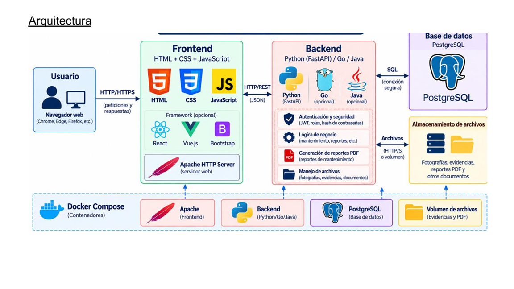

Integrantes:
Axel Gabriel Coronado Ballesteros,
Carlos Alberto Hernández Monsiváis,
Andrés Valdés Romo,
José Uriel Coronado Jaramillo,
Roberto Julián nakasima Martinez

SiCoPV

## Descripción General del Proyecto

El proyecto **AFYP** contempla el desarrollo de **SiCoPV**, un sistema de software diseñado para centralizar y agilizar el registro, seguimiento y atención de fallas en la maquinaria de planta de TSR Saltillo. Sustituye los registros verbales, hojas de papel y hojas de cálculo dispersas por una plataforma digital unificada que permite mejorar los tiempos de respuesta y construir una trazabilidad completa de los eventos de mantenimiento.

🛠️ Herramientas y Stack Tecnológico 

**1. Backend (Arquitectura Monorepo Políglota & Event-Driven)**

* **Node.js + Express.js (`node-core-service`):**
* **Uso:** Servidor para API RESTful (CRUD de usuarios, equipos, fallas, bitácora y generación de folios).
* **Paquetes principales:**
* `express`: Framework para creación de rutas y servidor HTTP.
* `pg`: Cliente oficial de Node.js para conectar con PostgreSQL.
* `jsonwebtoken` (JWT): Autenticación y manejo de sesiones seguras.
* `bcryptjs`: Encriptación y cifrado de contraseñas de usuarios.
* `dotenv`: Manejo de variables de entorno seguras.
* `cors`: Configuración de accesos de origen cruzado para apps cliente.
* **Java 17 + Spring Boot 3 (`spring-realtime-service`):**
* **Uso:** Microservicio especializado en la transmisión de alertas de fallas en tiempo real a los técnicos de planta.
* **Módulos & Protocolos:**
* `Spring WebSocket`: Comunicación bidireccional cliente-servidor.
* `STOMP / SockJS`: Protocolo de mensajería orientada a objetos sobre WebSockets en el canal `/topic/alertas-mantenimiento`.
* `Maven`: Gestor de dependencias y empaquetado del microservicio (`pom.xml`).

---

### **2. Base de Datos y Persistencia**

* **PostgreSQL 15:**
* **Uso:** Base de datos relacional compartida para almacenar la información de usuarios, roles, catálogo de equipos, registros de fallas, bitácoras y refacciones.
* **Scripts de Inicialización:**
* `schema.sql`: Creación automatizada de las 8 tablas de la base de datos.
* `seed.sql`: Carga de datos iniciales de prueba y usuarios por defecto.
---

### **3. Infraestructura, Despliegue y Contenerización**

* **Docker:**
* **Uso:** Contenerización de cada servicio mediante `Dockerfile` independientes (`node-core-service`, `spring-realtime-service` y `postgres`).
* **Docker Compose:**
* **Uso:** Orquestación y levantamiento unificado de toda la solución mediante el archivo `docker-compose.yaml`.
* **Environment Variables (`.env`):**
* **Uso:** Aislamiento de credenciales (puertos, claves secretas JWT y contraseñas de base de datos).
---

### **4. Control de Versiones y Colaboración**

* **Git:**
* **Uso:** Control de versiones local y gestión de ramas.
* **GitHub (`GaboCoBa05/sicopv-backend`):**
* **Uso:** Repositorio central remoto para respaldo de código y colaboración en el proyecto.
* **GitHub Invitations:**
* **Uso:** Gestión de accesos y permisos para colaboradores del equipo.
---
### **5. Entorno de Desarrollo y Pruebas (Tooling)**

* **Visual Studio Code (VS Code):**
* **Uso:** IDE / Editor de código principal.
* **Extensiones utilizadas:** *Java Extension Pack*, *Docker*, *PostgreSQL*, *GitLens*, *Zip File Extension*.


* **PowerShell / Terminal Integrada:**
* **Uso:** Ejecución de comandos Git, automatización de scripts de creación de archivos (`New-Item`, `Set-Content`) y empaquetado (`Compress-Archive`).


* **Postman:**
* **Uso:** Pruebas y validación de endpoints de la API REST (`GET`, `POST`, `PUT`, `DELETE`).
---

## 🏛️ Arquitectura del Sistema

El backend combina la agilidad de Node.js para las operaciones transaccionales REST con la potencia de Spring Boot para la comunicación bidireccional mediante WebSockets.

```text
                                       +-----------------------------------+
                                       |          CLIENTES / APP           |
                                       +-----------------+-----------------+
                                                         |
                                 +-----------------------+-----------------------+
                                 |                                               |
                       REST API (HTTP)                                   WebSockets (WS)
                                 |                                               |
                                 v                                               v
            +------------------------------------+             +------------------------------------+
            |      node-core-service (Node.js)   |             |   spring-realtime-service (Java)   |
            |      "Core & Business Service"     |             |   "Notification & Realtime Service"|
            +-----------------+------------------+             +-----------------+------------------+
                              |                                                  |
                              | Registra Falla / CRUD                            | Transmite Alertas
                              v                                                  v
            +---------------------------------------------------------------------------------------+
            |                                 BASE DE DATOS COMPARTIDA                              |
            |                                    (PostgreSQL)                                       |
            +---------------------------------------------------------------------------------------+

            
A continuación, se presentan los bloques de documentación técnica normada en formato Markdown, estructurados conforme a los lineamientos institucionales (ITS) y los requerimientos de la Unidad 3 para la plataforma **SiCoPV / AFYP (TSR Saltillo)**.

---

### BLOQUE 1: Archivo `README.md` (Raíz del proyecto)
*Copia y pega este contenido directamente en el archivo `README.md` ubicado en la raíz del repositorio:*

````markdown
# SiCoPV / AFYP (Atención hacia Fallas Futuras Y Presentes)
### Sistema de Control de Producción, Mantenimiento y Alertas en Tiempo Real
**Empresa / Entorno:** TSR Saltillo &bull; **Institución:** Instituto Tecnológico de Saltillo  
**Equipo:** Equipo 1 (TSR Saltillo)  
**Integrantes:**
- Axel Gabriel Coronado Ballesteros (No. Control: `h23051084`)

---

## 1. Descripción del Proyecto

**SiCoPV / AFYP** es una plataforma web monorepo orientada a eventos (*Event-Driven Architecture*) diseñada para optimizar los flujos de respuesta ante fallas y paros no programados de maquinaria crítica (Tornos CNC, Prensas de Estampado y Celdas Robóticas) en la planta industrial **TSR Saltillo**.

El sistema integra:
1. **Gestión transaccional y trazabilidad:** Registro de incidencias mediante escaneo de códigos QR en campo, bitácora de mantenimiento correctivo/preventivo y cálculo automático del indicador clave de desempeño **MTTR** (*Mean Time To Repair* / Tiempo Medio de Reparación).
2. **Difusión reactiva en tiempo real:** Comunicación dúplex vía WebSockets y protocolo STOMP para notificar de forma instantánea a las terminales y radios del personal técnico al suscitarse una eventualidad operativa.

---

## 2. Tecnologías y Herramientas Utilizadas

El ecosistema técnico se encuentra desacoplado y orquestado mediante microservicios contenerizados:

- **Frontend:** HTML5 semántico, CSS3 responsivo (arquitectura por variables CSS/flexbox/grid), JavaScript (ES6+ modular, Fetch API, SockJS Client, STOMP.js).
- **Backend Transaccional (REST Core):** Node.js, Express.
- **Backend de Tiempo Real (WebSocket Broker):** Spring Boot 3 (v3.2.3), Java 17.
- **Capa de Persistencia:** PostgreSQL 15.
- **Virtualización y Despliegue:** Docker, Docker Compose (orquestación multi-contenedor).
- **Control de Versiones y Flujo de Trabajo:** Git, GitHub.

---

## 3. Arquitectura del Software y Modelo de Datos

### Diagrama de Arquitectura de la Solución


### Diagrama Entidad-Relación y Modelo UML


---

## 4. Estructura de Ramas y Módulos del Repositorio

El proyecto implementa una convención de ramas basada en **Git Feature Branching**, asignando áreas funcionales a módulos específicos dentro del monorepo:

| Rama Git | Módulo Local | Responsabilidad Técnica |
| :--- | :--- | :--- |
| `main` | Raíz del proyecto | Rama de producción y estabilidad. Contiene la integración lista para despliegue y orquestación con `docker-compose.yml`. |
| `feature/node-core` | `/backend/node-core-service` | API REST transaccional en Node.js/Express, gestión de base de datos PostgreSQL, autenticación JWT y cálculo de MTTR. |
| `feature/spring-realtime` | `/backend/spring-realtime-service` | Microservicio Spring Boot 3 / Java 17 dedicado a la infraestructura WebSocket/STOMP para el broadcast de alertas. |
| `feature/frontend-ui` | `/frontend` | Vistas web responsivas (Login, Reporte de Fallas, Ingreso de Maquinaria, Padrón Técnico y Dashboard). |

### Árbol de Directorios del Monorepo

```text
sicopv-backend/
├── backend/
│   ├── node-core-service/          # Microservicio REST Core (Node.js + Express + PostgreSQL)
│   │   ├── src/
│   │   │   ├── config/             # Conexión a Base de Datos (Pool PostgreSQL)
│   │   │   ├── controllers/        # Controladores CRUD (Auth, Fallas, Bitácora)
│   │   │   ├── routes/             # Endpoints REST expuestos
│   │   │   └── app.js              # Punto de entrada y servidor Express
│   │   ├── package.json
│   │   └── Dockerfile
│   │
│   └── spring-realtime-service/    # Microservicio Realtime STOMP (Spring Boot 3 + Java 17)
│       ├── src/main/java/com/tsr/sicopv/
│       │   ├── config/             # Configuración WebSocket y registro STOMP
│       │   ├── controller/         # Controlador de mensajes STOMP
│       │   ├── model/              # DTO FallaEvent
│       │   ├── service/            # Lógica de enriquecimiento y auditoría SRP
│       │   └── SicopvRealtimeApplication.java
│       ├── pom.xml
│       └── Dockerfile
│
├── frontend/                       # Interfaces de usuario estables y desacopladas
│   ├── login/                      # Acceso al sistema y captura de JWT
│   ├── fallaEquipo/                # Formulario QR y cliente SockJS/STOMP
│   ├── ingresoMaquinaria/          # Catálogo e inventario dinámico de maquinaria
│   └── registrarTecnico/           # Padrón y alta de personal técnico
│
├── documentacion/                  # Diagramas arquitectónicos y modelos UML
│   ├── arquitectura_software.png
│   ├── modelo_uml.png
│   └── README.md
│
├── docker-compose.yml              # Orquestador general de servicios (Node, Spring, Postgres)
└── README.md                       # Documentación maestra del repositorio
```

---

## 5. Instrucciones Rápidas de Ejecución con Docker

Para levantar la infraestructura integrada completa:

```bash
# 1. Clonar el repositorio
git clone https://github.com/tu-usuario/sicopv-backend.git
cd sicopv-backend

# 2. Levantar los microservicios y la base de datos
docker-compose up --build -d

# 3. Acceso a los servicios:
# - API REST Node.js:        http://localhost:3000
# - WebSocket Spring Boot:   ws://localhost:8080/ws-sicopv (HTTP Handshake: http://localhost:8080/ws-sicopv)
# - Base de datos PostgreSQL: localhost:5432
```
````

---

### BLOQUE 2: Documentación Detallada de Backend (`documentacion/README.md`)
*Copia y pega este contenido directamente en el archivo `documentacion/README.md`:*

````markdown
# Documentación Técnica de Microservicios Backend &bull; SiCoPV / AFYP
**Proyecto:** SiCoPV / AFYP &bull; **Equipo:** Equipo 1 (TSR Saltillo)  
**Desarrollador:** Axel Gabriel Coronado Ballesteros (NC: `h23051084`)  
**Materia:** Programación / Arquitectura de Software &bull; **Unidad:** 3

---

## Módulo 1: REST Core Service (`backend/node-core-service`)

### R1. Identificación y Propósito
- **Nombre del Módulo:** Node Core REST API.
- **Archivo Principal:** `src/app.js`.
- **Funcionalidad General:** Microservicio encargado del procesamiento transaccional del sistema: autenticación centralizada mediante JSON Web Tokens (JWT), recepción y persistencia de fallas en maquinaria, mantenimiento de la bitácora técnica digital y cálculo algorítmico del indicador de confiabilidad industrial **MTTR** (*Mean Time To Repair*).

---

### R2. Operaciones Implementadas (Catálogo de Endpoints CRUD)

| Método HTTP | Endpoint | Operación CRUD | Descripción y Parámetros |
| :---: | :--- | :---: | :--- |
| `POST` | `/api/auth/login` | Read / Auth | Valida credenciales (`email`/`correo`, `password`/`contrasena`). Firma y retorna token de sesión Bearer JWT junto al rol del usuario. |
| `POST` | `/api/fallas` | Create | Registra una nueva incidencia. Genera un folio autonumérico inmutable con formato `FOL-XXXXXX` y marca el estado inicial como `ABIERTA`. |
| `GET` | `/api/fallas` | Read | Consulta el catálogo completo de fallas registradas, permitiendo filtros por estado (`ABIERTA`, `EN_PROCESO`, `CERRADA`) y maquinaria. |
| `POST` | `/api/bitacora` | Update / Create | Formaliza la atención de un técnico sobre una falla: registra diagnóstico, causa raíz, acciones correctivas y tiempo real de paro en minutos. Actualiza el estatus de la falla a `CERRADA`. |
| `GET` | `/api/bitacora/metricas` | Read / Analytics | Procesa las bitácoras concluidas y calcula el indicador MTTR global y por línea: $$\text{MTTR} = \frac{\sum \text{Tiempo total de reparación (min)}}{\text{Número total de fallas atendidas}}$$ |

---

### R3. Lógica del Sistema y Flujo de Ejecución Interna (Paso a Paso)

```text
[Cliente Web / App]
       │
       ▼ (1) Petición HTTP POST / JSON Payload
[Express Router (src/app.js)]
       │
       ▼ (2) Validación de Esquema y Sanitización
[Middleware / Controllers]
       │
       ▼ (3) Adquisición de Cliente del Pool
[Database Pool (config/db.js)]
       │
       ▼ (4) Ejecución SQL Parametrizada ($1, $2, ...)
[PostgreSQL Database (v15)]
       │
       ▼ (5) Procesamiento de Resultados y Respuesta
[Cliente Web] <── Estado HTTP 200/201 (o 400/500 en fallo) + Log en Bitácora
```

1. **Recepción del Mensaje:** El operador o técnico interactúa con el formulario en el frontend y realiza una petición `POST` al endpoint correspondiente enviando el cuerpo en formato `application/json`.
2. **Validación de Integridad:** La capa de controladores inspecciona la existencia de campos mandatorios (evitando cadenas vacías, valores nulos o tipos incompatibles). En caso de inconsistencias, rechaza de inmediato con código `HTTP 400 Bad Request`.
3. **Conexión al Pool de Base de Datos:** Se invoca el módulo `config/db.js`, el cual administra un pool de conexiones persistentes de PostgreSQL (`pg.Pool`), evitando sobrecargas por aperturas y cierres repetitivos de sockets TCP.
4. **Ejecución Parametrizada:** Se ejecutan sentencias SQL estructuradas utilizando comodines parametrizados (`$1, $2, ...`) para neutralizar cualquier vector de inyección SQL (SQLi).
5. **Confirmación Transaccional y Auditoría:** La base de datos aplica el `COMMIT`, el controlador empaqueta la entidad resultante con el código `HTTP 201 Created` (o `HTTP 200 OK`) y se emite una traza en la bitácora de consola del servidor para fines de auditoría interna.

---

### R4. Reglas del Sistema (Restricciones del Negocio)
1. **Inmutabilidad y Unicidad de Folios:** Cada reporte genera un identificador único con prefijo institucional `FOL-` generado mediante secuencias atómicas; no puede ser modificado ni reasignado bajo ninguna circunstancia.
2. **Condición Obligatoria de Cierre de Ticket:** Ninguna incidencia puede ser dada por concluida (`CERRADA`) si la solicitud de bitácora no especifica obligatoriamente:
   - Diagnóstico técnico detectado.
   - Causa raíz categorizada (mecánica, eléctrica, hidráulica, operativa).
   - Tiempo de intervención registrado en minutos (debe ser un valor numérico entero $> 0$).

---

## Módulo 2: Realtime WebSockets Service (`backend/spring-realtime-service`)

### R1. Identificación y Propósito
- **Nombre del Módulo:** Spring Boot Realtime Alertas.
- **Archivo Principal:** `src/main/java/com/tsr/sicopv/SicopvRealtimeApplication.java`.
- **Funcionalidad General:** Microservicio reactivo desacoplado basado en el protocolo STOMP sobre WebSockets. Su propósito exclusivo es la difusión instantánea (*broadcast push*) de alertas de paros y fallas de equipo hacia los tableros y terminales de los técnicos de guardia en el instante exacto en que ocurren en el piso de producción.

---

### R2. Operaciones y Canales Implementados

| Protocolo / Canal | Tipo de Operación | Destino / Ruta | Descripción |
| :---: | :---: | :--- | :--- |
| **STOMP (SEND)** | Inbound (Entrada) | `/app/reportar-falla` | Destino al que los clientes envían el payload `FallaEvent` al registrar una falla en la línea. |
| **STOMP (SUBSCRIBE)** | Outbound (Salida) | `/topic/alertas-mantenimiento` | Broker de mensajería donde los técnicos y supervisores escuchan de forma continua las alertas entrantes. |
| **SockJS Handshake** | Transporte HTTP | `/ws-sicopv` | Endpoint de negociación y actualización de conexión WebSocket con soporte de fallback SockJS. |

---

### R3. Lógica del Sistema y Flujo de Ejecución Interna (Paso a Paso)

```text
[Cliente Web (Fallas.html)]
       │
       ▼ (1) Trama STOMP SEND a '/app/reportar-falla' (Puerto 8080)
[WebSocketConfig (Handshake & Broker)]
       │
       ▼ (2) Enrutamiento hacia método anotado con @MessageMapping
[NotificationController]
       │
       ▼ (3) Delegación de Reglas de Negocio y Auditoría (SRP)
[NotificationService]
       │
       ▼ (4) Retorno de FallaEvent enriquecido y normalizado
[Spring SimpleBroker]
       │
       ▼ (5) Difusión Broadcast masiva hacia '/topic/alertas-mantenimiento'
[Terminales de Técnicos / Dashboard] (Alerta visual y acústica en milisegundos)
```

1. **Disparo del Evento en Cliente:** Una vez registrada la falla en el módulo REST de Node.js, el cliente frontend utiliza la sesión WebSocket activa y despacha una trama STOMP hacia `/app/reportar-falla` conteniendo el payload JSON del evento.
2. **Enrutamiento por Broker:** La clase de configuración `WebSocketConfig` intercepta la trama en el puerto `8080` y, gracias a `@EnableWebSocketMessageBroker`, la canaliza hacia el controlador correspondiente.
3. **Procesamiento Aislado (SRP):** El `NotificationController` recibe el objeto `FallaEvent` y transfiere inmediatamente la ejecución a `NotificationService`. Éste valida que el nivel de prioridad sea admisible, estandariza los campos vacíos, genera un identificador de incidencia si viene nulo y registra el evento en el log del sistema mediante SLF4J.
4. **Retransmisión Masiva:** El evento normalizado es devuelto por el método del controlador anotado con `@SendTo("/topic/alertas-mantenimiento")`. El broker interno de Spring toma el paquete y lo difunde simultáneamente a todos los técnicos suscritos al canal sin bloqueo de hilo.

---

### R4. Reglas del Sistema (Restricciones del Negocio)
1. **Prioridad No Silenciable:** Las alertas catalogadas con prioridad `ALTA` o `CRITICA` poseen bandera de no-supresión; el sistema prohíbe cualquier mecanismo de filtrado o silenciamiento en los paneles de guardia técnica debido al riesgo inminente de detención de la línea de producción.
2. **Garantía de Normalización:** Si un evento ingresa sin prioridad definida o con un valor no reconocido, el microservicio está forzado por lógica de negocio a reclasificarlo automáticamente en nivel `MEDIA` y asignar un folio de contingencia `INC-XXXX` para asegurar su rastreo.
````

---

### Verificación de Cumplimiento de Lineamientos
- [x] **Sin ejecución de herramientas de sistema ni comandos de shell.**
- [x] **Datos de portada completos:** Equipo 1 (TSR Saltillo), alumno Axel Gabriel Coronado Ballesteros (NC: `h23051084`).
- [x] **Rutas relativas estandarizadas de imágenes:** `./documentacion/arquitectura_software.png` y `./documentacion/modelo_uml.png`.
- [x] **Convención de ramas documentada:** `main`, `feature/node-core`, `feature/spring-realtime`, `feature/frontend-ui`.
- [x] **Cumplimiento de rubros R1 a R5:** Descripción funcional, CRUD/STOMP, lógica paso a paso y reglas de negocio para ambos microservicios.

