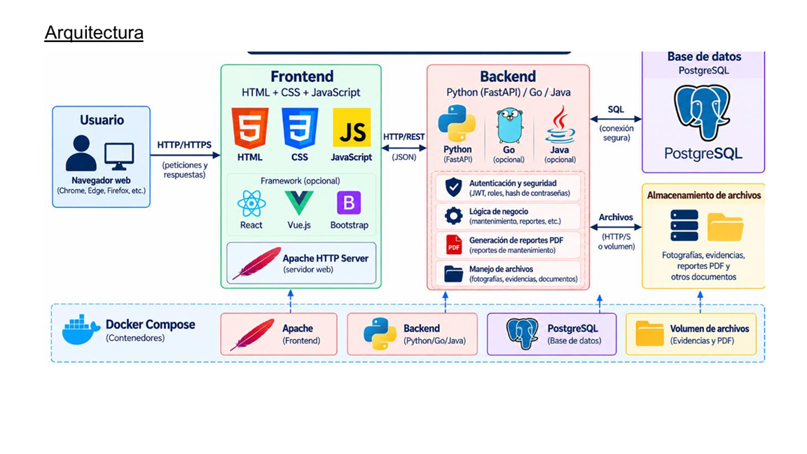

# AFYP - Atención hacia Fallas Futuras Y Presentes
## SiCoPV &bull; Sistema de Control de Paros y Ventanillas de Mantenimiento

**Cliente Industrial:** TSR Saltillo (Sector Automotriz)  
**Institución:** Instituto Tecnológico de Saltillo  
**Docente:** Ing. Alejandra Margarita Sánchez Malacara  
**Equipo de Desarrollo:**
- Roberto Julián Nakasima Martinez
- Uriel Coronado Jaramillo
- Carlos Alberto Hernandez Monsivais
- Andrés Valdés Romo
- Axel Gabriel Coronado Ballesteros

---

## 1. Descripción General del Proyecto

**SiCoPV / AFYP** es una solución monorepo orientada a eventos (*Event-Driven Architecture*) concebida para la planta industrial **TSR Saltillo**. Su objetivo es erradicar los registros físicos en papel, hojas de cálculo aisladas y reportes verbales, proporcionando un ecosistema integral para la detección, notificación en tiempo real, trazabilidad y resolución de paros de maquinaria crítica (Tornos CNC, Prensas Hidráulicas/Mecánicas y Celdas de Soldadura Robótica).

El sistema digitaliza el ciclo completo de vida del mantenimiento:
1. **Reporte Rápido por Código QR:** Lectura de placas de maquinaria en línea de producción para el levantamiento inmediato de fallas.
2. **Difusión en Tiempo Real:** Emisión instantánea de alertas acústicas y visuales a los técnicos de guardia vía WebSockets / STOMP.
3. **Bitácora Digital y Cierre de Tickets:** Cronometraje de tiempos de intervención, registro obligatorio de causa raíz y control de refacciones empleadas.
4. **Mantenimiento Preventivo Planificado:** Programación de tareas y reemplazo de componentes según horas de operación.
5. **Analítica de Confiabilidad Industrial:** Cálculo automatizado de los indicadores **MTBF** (*Mean Time Between Failures*) y **MTTR** (*Mean Time To Repair*).
6. **Certificación y Auditoría en PDF:** Emisión de reportes formales de cierre listos para descargar e imprimir bajo norma IATF 16949.

---

## 2. Herramientas y Stack Tecnológico

El sistema implementa una arquitectura políglota desacoplada y contenerizada:

- **Frontend Web:** HTML5 semántico, CSS3 responsivo (paleta institucional verde oscuro `#0B3B36` / `#135D54`), JavaScript modular (ES6+, Fetch API, SockJS, STOMP.js, Chart.js).
- **Backend Transaccional REST (`backend/node-core-service`):** Node.js, Express, PostgreSQL Client (`pg`), JSON Web Tokens (`jsonwebtoken`), encriptación con `bcryptjs`, generación de reportes con `pdfkit`.
- **Backend Reactivo Realtime (`backend/spring-realtime-service`):** Java 17, Spring Boot 3 (v3.2.3), Spring WebSocket, STOMP Broker, Maven.
- **Base de Datos Relacional (`backend/baseDeDatos`):** PostgreSQL 15 con esquemas normalizados y datos semilla iniciales.
- **Contenerización y Despliegue:** Docker, Docker Compose (`docker-compose.yml`).
- **Control de Versiones y Gestión:** Git, GitHub (`GaboCoBa05/sicopv-backend`).

---

## 3. Arquitectura del Software y Modelo de Datos

### Diagrama de Arquitectura de la Solución


### Diagrama Relacional y Modelo UML


---

## 4. Estructura de Ramas y Mapeo de Módulos

El repositorio sigue la convención de ramas para desarrollo modular en equipo:

| Rama Git | Módulo Local | Responsabilidad Técnica |
| :--- | :--- | :--- |
| `main` | Raíz del proyecto | Rama de producción estable. Contiene la orquestación final con `docker-compose.yml`. |
| `feature/node-core` | `/backend/node-core-service` | API REST para CRUD de usuarios, maquinaria, fallas, bitácora, preventivos y generación de PDF. |
| `feature/spring-realtime` | `/backend/spring-realtime-service` | Microservicio Spring Boot 3 para transmisión STOMP sobre WebSockets (`/ws-sicopv`). |
| `feature/frontend-ui` | `/frontend` | Vistas web responsivas para operadores, técnicos y supervisores de planta. |

---

## 5. Implementación de los 9 Casos de Uso (CU)

| Caso de Uso | Módulo / Endpoint | Descripción Funcional |
| :--- | :--- | :--- |
| **CU-01: Autenticación y Usuarios** | `POST /api/auth/login`<br>`POST /api/auth/register`<br>`PUT /api/auth/reset-password` | Inicio de sesión con JWT, registro con control de roles (`ADMIN`, `JEFE_MANTTO`, `TECNICO`, `OPERADOR`, `SUPERVISOR`, `CALIDAD`) y restablecimiento de contraseña. |
| **CU-02: Reportar Falla de Equipo** | `POST /api/fallas`<br>`GET /api/fallas` | Lectura QR, generación de folio único inmutable (`FOL-XXXXXX`), cambio automático de estado a `EN_PARO` y emisión de alerta STOMP. |
| **CU-03: Actualizar Bitácora Digital** | `POST /api/bitacora`<br>`GET /api/bitacora` | Cronómetro de intervención técnica, captura obligatoria de causa raíz y refacciones, cierre de ticket (`CERRADA`) y restauración a `OPERATIVO`. |
| **CU-04: Registrar Técnicos** | `POST /api/tecnicos`<br>`GET /api/tecnicos` | Alta de personal en `usuarios` y `tecnicos` con área (`Mantenimiento`, `Eléctrica`, `Mecánica`) y especialidad técnica, validando duplicados. |
| **CU-05: Mantenimiento Preventivo** | `POST /api/preventivos`<br>`GET /api/preventivos` | Planificación por período de uso (horas), piezas a sustituir y tareas programadas por activo para evitar paros no programados. |
| **CU-06: Registrar Maquinaria** | `POST /api/equipos`<br>`GET /api/equipos/qr/:qr` | Catálogo de máquinas con número de serie único, función, área y generación de etiqueta `QR-TSR-<SERIE>` lista para impresión. |
| **CU-07: Dashboard MTBF y MTTR** | `GET /api/dashboard/eficiencia` | Cálculo algorítmico dinámico en backend de Disponibilidad (%), MTBF (Horas) y MTTR (Minutos), graficados con Chart.js. |
| **CU-08: Reporte de Salida en PDF** | `GET /api/reportes/pdf/:folio` | Descarga de documento formal membretado para auditoría IATF con firmas de técnico y supervisor. |
| **CU-09: Alertas en Tiempo Real** | `/app/reportar-falla`<br>`/topic/alertas-mantenimiento` | Difusión broadcast push vía SockJS y STOMP (`ws://localhost:8080/ws-sicopv`) a todas las terminales de planta en milisegundos. |

---

## 6. Ejecución y Despliegue con Docker

Levantar el entorno completo e integrado:

```bash
# 1. Posicionarse en la raíz del repositorio
cd sicopv-backend

# 2. Iniciar todos los contenedores en segundo plano
docker compose up --build -d

# 3. Puntos de acceso:
# - Frontend Web:            http://localhost:3000/frontend/login/login.html
# - API REST Node.js:        http://localhost:3000/api
# - WebSocket STOMP Spring:  ws://localhost:8080/ws-sicopv (HTTP Handshake: http://localhost:8080/ws-sicopv)
# - Base de Datos PostgreSQL: localhost:5432 (BD: sicopv_db, Usuario: postgres, Clave: admin)
```
